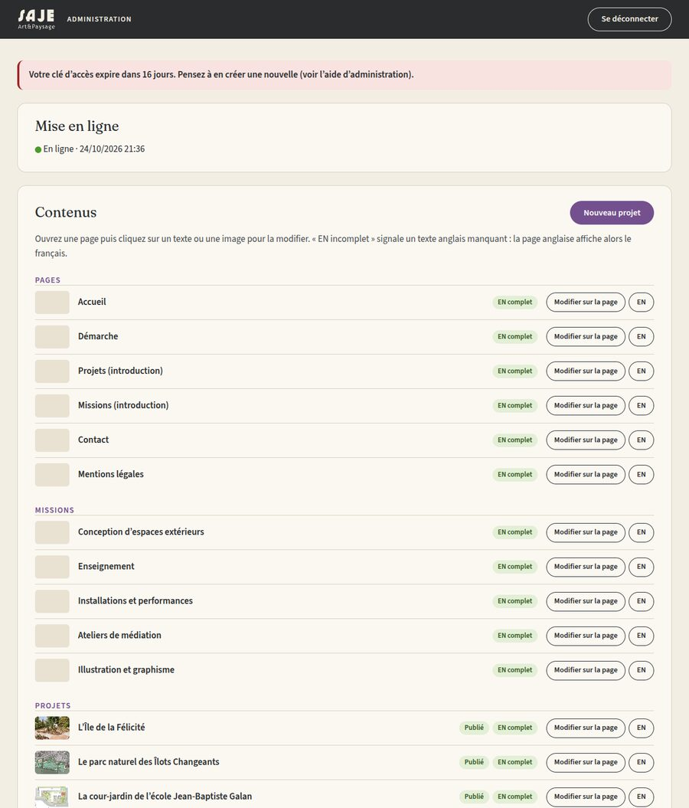
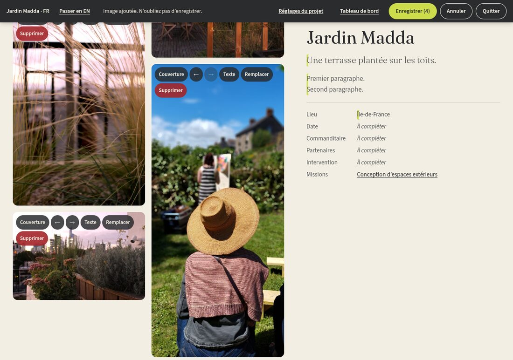

# Modifier le site : mode d'emploi

Ce guide explique comment corriger un texte, changer une photo ou ajouter un projet sur sajepaysage.fr, depuis un ordinateur ou un téléphone. Aucune connaissance technique n'est nécessaire.

Chaque enregistrement est mis en ligne automatiquement en 1 à 2 minutes. Rien n'est jamais perdu : toutes les versions précédentes restent dans l'historique.

## 1. Créer votre clé d'accès (une fois par an)

La clé d'accès est un long code fourni par GitHub, le service qui héberge le site. Elle ne permet de modifier que ce site.

1. Connectez-vous à GitHub, puis ouvrez [github.com/settings/personal-access-tokens](https://github.com/settings/personal-access-tokens).
2. Cliquez sur **Generate new token**.
3. Remplissez :
   - **Token name** : `Site SAJE` ;
   - **Expiration** : 1 an (choisissez une date dans un an) ;
   - **Repository access** : **Only select repositories**, puis choisissez le dépôt du site ;
   - **Permissions** › **Repository permissions** : **Contents** sur **Read and write**, et **Actions** sur **Read-only** (cette seconde ligne sert à afficher l'état de la mise en ligne).
4. Cliquez sur **Generate token** et copiez le code qui commence par `github_pat_`. GitHub ne le montrera plus : gardez cette page ouverte jusqu'à l'étape suivante.

Un mois avant l'expiration, le tableau de bord affiche un avertissement : recommencez simplement ces étapes.

## 2. Se connecter

1. Ouvrez **sajepaysage.fr/admin/**.
2. Collez la clé dans le champ **Clé d'accès**, puis **Se connecter**.

La clé reste enregistrée dans ce navigateur : sur cet appareil, vous n'aurez plus à la saisir. Sur un ordinateur partagé, cliquez sur **Se déconnecter** en partant.

Le tableau de bord montre :

- l'**état de la mise en ligne** (pastille verte : en ligne ; orange : en cours ; rouge : erreur) ;
- la **liste des contenus**, avec pour chaque projet « Publié » ou « Masqué », et « EN incomplet » si un texte anglais manque (la page anglaise affiche alors le français) ;
- l'**ordre des projets**, le **diaporama** et les trois projets **À la une** de l'accueil ;
- l'**historique** des 20 dernières modifications.

## 3. Modifier un texte

1. Dans le tableau de bord, cliquez sur **Modifier sur la page** à côté du contenu voulu (ou **EN** pour la version anglaise). Vous pouvez aussi naviguer sur le site : un bouton **Modifier cette page** apparaît en bas à droite de chaque page tant que vous êtes connectée.
2. Une barre noire s'affiche en haut. Les textes modifiables s'entourent d'un pointillé violet au survol : **cliquez dessus et écrivez**.
3. Pour les descriptifs, une petite barre propose **gras**, *italique* et **lien**.
4. Les champs vides de la fiche projet (lieu, date, commanditaire…) n'apparaissent qu'en mode édition, avec l'invite « À compléter ».
5. Cliquez sur **Enregistrer** : le bouton indique le nombre de modifications en attente. Le message « Enregistré. En ligne dans environ 2 minutes » confirme l'envoi.

**Annuler** abandonne les modifications non enregistrées ; **Quitter** sort du mode édition.

Sur une page anglaise, les textes encadrés en orange sont affichés en français faute de traduction : écrivez la version anglaise directement à leur place.

## 4. Changer, ajouter ou retirer des photos

En mode édition, chaque image porte des boutons :

| Bouton | Effet |
| --- | --- |
| **Couverture** | Image utilisée pour la carte du projet et le partage sur les réseaux |
| **←** **→** | Déplace l'image dans la galerie |
| **Texte** | Texte alternatif (description pour les personnes qui ne voient pas l'image) et légende, en français et en anglais |
| **Remplacer** | Choisit une autre photo à la place |
| **Supprimer** | Retire l'image du projet |

Sous la galerie, **+ Ajouter des images** accepte plusieurs photos à la fois, y compris depuis l'appareil photo d'un téléphone. Les photos sont réduites automatiquement (2 400 pixels au plus) et leurs informations cachées, dont la position GPS, sont effacées avant l'envoi.

Le **texte alternatif en français est obligatoire** : décrivez en une phrase ce que montre l'image (« Allée de sable bordée de graminées vers des panneaux blancs »).

## 5. Ajouter un projet

1. Dans le tableau de bord, cliquez sur **Nouveau projet**.
2. Indiquez le titre en français et cochez les catégories, puis **Créer le projet**.
3. Le projet est créé **masqué**. Une fois en ligne (environ 2 minutes), sa page s'ouvre en mode édition : ajoutez textes et images, puis enregistrez.
4. Pour le publier, cliquez sur **Réglages du projet** dans la barre noire, cochez **Publié**, **Appliquer**, puis **Enregistrer**.

Les **Réglages du projet** permettent aussi de changer ses catégories (les filtres de la page Projets), ses missions liées et sa position dans la liste. Pour masquer un projet sans le supprimer, décochez **Publié**.

## 6. Réorganiser l'accueil et la liste des projets

- **Ordre des projets** : flèches ↑ ↓ (ou glisser-déposer sur ordinateur), puis **Enregistrer l'ordre**.
- **Diaporama** : réordonnez ou retirez les images ; **Ajouter une image au diaporama** propose les photos de chaque projet. Puis **Enregistrer l'accueil**.
- **À la une** : choisissez les trois projets dans les listes, puis **Enregistrer l'accueil**.

## 7. Revenir en arrière

Dans **Historique**, ouvrez une modification : la liste des fichiers concernés s'affiche. **Revenir à cette version** rétablit un fichier tel qu'il était juste après cette modification.

## En cas de problème

| Message | Que faire |
| --- | --- |
| « La clé d'accès n'est plus valide » | Créez une nouvelle clé (étape 1) puis reconnectez-vous |
| « … a été modifié ailleurs depuis l'ouverture de cette page » | Quelqu'un (ou vous, dans un autre onglet) a modifié la même page. Copiez votre texte, rechargez la page et recommencez |
| Pastille rouge « Erreur lors de la mise en ligne » | Vos modifications sont enregistrées mais la page n'a pas été reconstruite : prévenez la personne qui gère le site |
| La modification n'apparaît pas | Attendez 2 minutes puis rechargez la page (sur téléphone, fermez et rouvrez l'onglet) |
